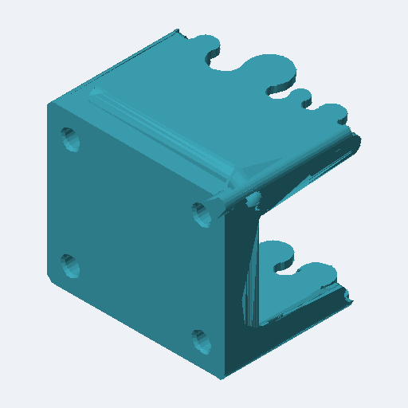

# Bubble Speaker Housing V2 — Fit Prototype

[Download on Printables](https://www.printables.com/model/1912700-bubble-speaker-housing-v2-fit-prototype/files)

Isaiah Dupree designed this curved housing for the SourSides speaker-stand project. It has four modeled mounting holes and two patterned side panels.

The original V2 STL measures about 238 × 208 × 210 mm in its model axes. The optional compact STL measures about 91 × 80 × 80 mm. Check the enclosure and hole pattern against your hardware before slicing. Choose a stable face, inspect supports for the side panels, and check the bed envelope.

Orion verified the geometry of both STL files. Speaker fit, acoustics, thermal behavior, and mount strength are unverified. Keep the prototype unloaded while checking fit.

Licence CC BY-NC-SA 4.0. Credit Isaiah Dupree when sharing or remixing.

## Files

- [bubble-speaker-housing-v2.stl](files/bubble-speaker-housing-v2.stl)
- [bubble-speaker-housing-v2.zip](files/bubble-speaker-housing-v2.zip)
- [Compact 91 mm housing STL](files/bubble-speaker-compact-91mm.stl)

[Printables download verification](evidence/publication-verification.json) · [Preview verification](evidence/geometry-previews.json)
