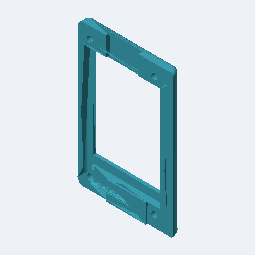
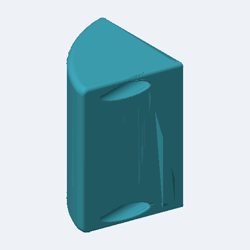

# ESP32 Display Fit Bezel V3

[Download on Printables](https://www.printables.com/model/1912978-esp32-display-fit-bezel-v3/files)

A small display-frame prototype from the Cypress ESP32 Display project. The rectangular frame has four mounting holes and relief along its short edges. The outside size is approximately 59.6 × 95.4 mm with a 6 mm depth.

Use the supplied STEP to check the actual screen opening, screw centers, connector access and rear clearance against your module. Place the broad face on the bed where your slicer shows continuous first-layer contact.

The original ZIP contains the standalone bezel. The optional 7 mm panel face and rear mount share 43.4 × 80.03 mm screw centers. Orion checked the matching meshes and STEP solids and found zero volume overlap between the optional parts in their archived alignment. The display SKU, physical fit, and compatibility between the optional set and the V3 bezel remain unverified.

| Optional 7 mm panel face | Optional rear mount |
| --- | --- |
|  |  |

Licence CC BY-NC-SA 4.0. Credit Isaiah Dupree when sharing or remixing.

## Files

- [display-template-v3.stl](files/display-template-v3.stl)
- [esp32-display-fit-bezel-v3.zip](files/esp32-display-fit-bezel-v3.zip)
- Optional 7 mm panel face · [STL](files/esp32-optional-panel-face-7mm.stl) · [STEP](files/esp32-optional-panel-face-7mm.step)
- Optional rear mount · [STL](files/esp32-optional-panel-mount.stl) · [STEP](files/esp32-optional-panel-mount.step)

[Printables download verification](evidence/publication-verification.json) · [Preview verification](evidence/geometry-previews.json)
