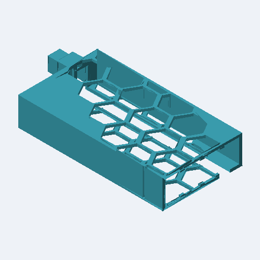
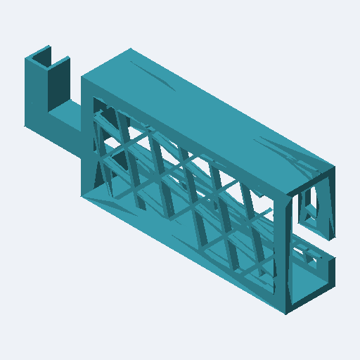

# Vented Power Adapter Cradle V2

[Download on Printables](https://www.printables.com/model/1912977-vented-power-adapter-cradle-v2/files)

A printable cradle with a honeycomb web and an open end for checking the fit of a laptop power adapter. The original project used an Acer Predator adapter as its target. The specific adapter part number was absent from the source.

The V2 cradle measures about 185 × 80.3 × 29.1 mm at its outside extremes. The short variant measures about 174 × 80 × 29 mm, and the triangular variant measures about 225 × 41 × 87 mm. Compare the interior and cord exit in the relevant STEP file with your adapter, including raised feet and strain relief. Slice the web and clip areas to confirm the toolpaths are continuous.

Use these prototypes for bench fit with the adapter unplugged. Orion checked the geometry digitally. Adapter fit, temperature, powered ventilation, and long-term retention remain unverified.

| Short cradle | Triangular cradle |
| --- | --- |
|  |  |

Licence CC BY-NC-SA 4.0. Credit Isaiah Dupree when sharing or remixing.

## Files

- [charger-cradle-v2.stl](files/charger-cradle-v2.stl)
- [power-adapter-cradle-v2.zip](files/power-adapter-cradle-v2.zip)
- Short 174 mm cradle · [STL](files/power-adapter-short-cradle-174mm.stl) · [STEP](files/power-adapter-short-cradle-174mm.step)
- Triangular 225 mm cradle · [STL](files/power-adapter-triangular-cradle-225mm.stl) · [STEP](files/power-adapter-triangular-cradle-225mm.step)

[Printables download verification](evidence/publication-verification.json) · [Preview verification](evidence/geometry-previews.json)
