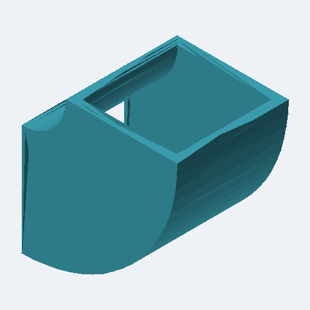
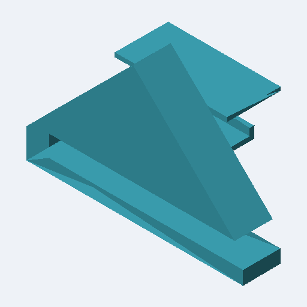
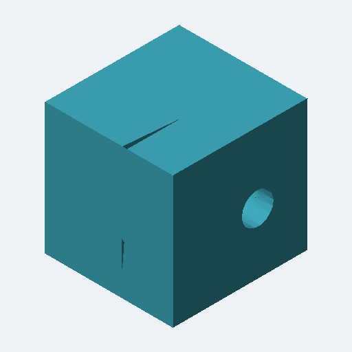
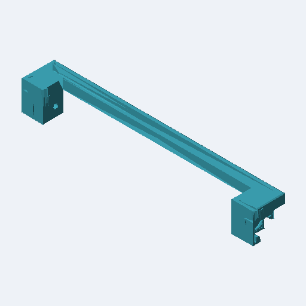

# Workbench LED Strip Mounting Parts

[Download on Printables](https://www.printables.com/model/1912981-workbench-led-strip-mounting-parts/files)

The original kit from the Cypress workbench lighting project includes a small screw block, a long strip carrier and a shaped corner support. The optional layout parts add a 28 mm right-angle connector, an 81 mm island connector, a 20 mm screw block, and a 236.5 mm carrier with a 30.5 mm profile. Use the editable STEP files to compare the channels and fastener holes with your bench and LED strip.

The original block is about 21.5 × 21.0 × 20.5 mm, the original carrier also spans 236.5 mm, and the corner support is roughly 78.4 × 97.4 × 25.0 mm. Leave room for adhesion and supports on the long parts. Check the finished print near any warm LEDs or aluminum channel before installing it.

Orion checked the STL meshes and reloaded the matching STEP files. Hardware fit, thermal performance, and long-term mounting strength remain unverified.

| Right-angle connector | Island connector |
| --- | --- |
|  |  |

| Screw block | Low-profile carrier |
| --- | --- |
|  |  |

Licence CC BY-NC-SA 4.0. Credit Isaiah Dupree when sharing or remixing.

## Files

- [led-strip-block-v2.stl](files/led-strip-block-v2.stl)
- [led-strip-connector-v2.stl](files/led-strip-connector-v2.stl)
- [led-strip-corner.stl](files/led-strip-corner.stl)
- [workbench-led-strip-mounts.zip](files/workbench-led-strip-mounts.zip)
- Right-angle connector · [STL](files/led-right-angle-connector-28mm.stl) · [STEP](files/led-right-angle-connector-28mm.step)
- Island connector · [STL](files/led-island-connector-81mm.stl) · [STEP](files/led-island-connector-81mm.step)
- Screw block · [STL](files/led-strip-screw-block-20mm.stl) · [STEP](files/led-strip-screw-block-20mm.step)
- Low-profile carrier · [STL](files/led-strip-low-profile-carrier-236mm.stl) · [STEP](files/led-strip-low-profile-carrier-236mm.step)

[Printables download verification](evidence/publication-verification.json) · [Preview verification](evidence/geometry-previews.json)
